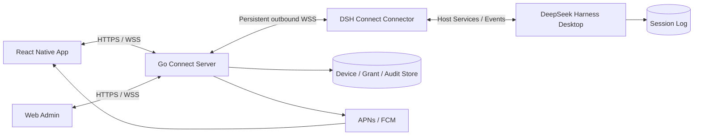
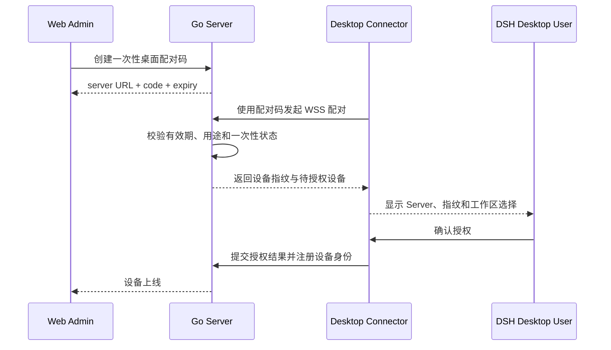

# DSH Connect 系统架构设计

- 文档状态：方案设计
- 版本：v1.0
- 日期：2026-10-27
- 适用范围：个人开发者、小团队、自托管或私有部署

## 1. 背景与结论

DSH Connect 的目标是让移动端安全地控制正在桌面端运行的 DeepSeek Harness，并由 Go Server 提供设备、协议、权限与中继能力。

采用 **React Native App + Go Server + DSH Connect Connector + Web 管理后台** 可行。关键约束是：Go Server 不应直接读取 DSH 会话文件，也不能直接调用 DSH 进程内 Service；真正的 DSH 操作由桌面 Connector 通过 Host API 完成。

原型预览文件与 Connector 是两个完全不同的对象：

- 原型只用于展示交互，无真实集成。
- Connector 是未来产品组件，负责真实的桌面接入。

## 2. 架构目标

1. 支持会话列表、历史查看、流式输出、发送提示词和取消。
2. 支持多手机、多桌面和按工作区授权。
3. 桌面无需开放公网入站端口。
4. 断线恢复不重复提交指令、不丢失持久化事件。
5. 远程审批保持 DSH 审批语义并默认失败关闭。
6. Server 不作为会话事实源，不替代 DSH 执行 Agent。
7. 移动端后台不可用时，通过通知与恢复同步保证体验。

## 3. 非目标

首版不包含：

- 完整移动 IDE。
- 远程桌面或屏幕共享。
- 任意 Shell、任意文件路径读写。
- 远程关闭 DSH 审批。
- 用 Go Server 重新实现 Agent 或模型调用。
- 直接读取、修改 DSH 内部存储格式。

## 4. DSH 能力依据

当前 DSH Host Inspect 已确认以下核心能力：

| 能力 | Host 接口或事件 | 用途 |
|---|---|---|
| 会话列表 | `sessionController.list()` | App 和后台会话目录 |
| 创建会话 | `sessionController.create()` | 新会话 |
| 历史分页 | `sessionController.page()` | 冷读取与历史补拉 |
| 发送提示词 | `sessionController.prompt()` | `queue` / `steer` |
| 取消 Turn | `sessionController.cancel()` | 远程停止当前任务 |
| 会话订阅 | `sessionController.follow()` | 快照、持久事件、assistant stream |
| 会话事件 | `session/event` | 已提交事件观察 |
| 审批请求 | `approval/request` | 远程审批适配 |
| 工作区管理 | Workspace 相关 Service | 工作区目录和授权映射 |
| 附件 | `sessionController.attachment()` 等 | 后续图片能力 |

`follow()` 返回 opening snapshot、可按照 cursor 继续的持久化事件，以及可选的实时 assistant stream，是断线恢复的主要接口。

所有 DSH 版本相关类型和映射应限制在 Connector 内，外部 App 与 Go Server 使用稳定的版本化 DTO。

## 5. 总体架构



### 5.1 控制面与数据面

- **控制面**：用户、设备、配对、授权、命令路由、审计和通知。
- **会话数据面**：Connector 从 DSH 获取快照、历史与实时事件，经 Server 中继给 App。
- **执行面**：始终位于桌面 DSH，包含工作区、工具、权限与审批。

## 6. 组件职责

### 6.1 DSH Connect Connector

1. 与 Server 建立经过设备认证的持久 WSS。
2. 将外部 RPC 转换为 DSH Host Service 调用。
3. 管理 `sessionController.follow()` 生命周期。
4. 将 DSH 事件映射为稳定、版本化的外部事件。
5. 维护命令超时、取消与幂等信息。
6. 转发审批请求并接回一次性审批结果。
7. 限制可访问设备、工作区和动作。
8. 在桌面展示 Server、设备指纹、工作区授权和连接状态。

初版推荐 Connector 直接建立出站连接，不额外要求桌面 Go 守护进程。

### 6.2 Go Server

| 模块 | 职责 |
|---|---|
| API Gateway | App/Admin REST 与 WebSocket 接入 |
| Pairing & Auth | 一次性配对码、设备身份、令牌轮换与吊销 |
| Device Hub | Connector/App 在线连接、心跳和设备代际管理 |
| Command Router | 按用户、设备、会话路由命令 |
| Idempotency | 按 `requestId` 去重和保存处理状态 |
| Event Fanout | 向多个 App/Admin 客户端广播事件 |
| Push Service | 完成、失败、等待输入和审批通知 |
| Audit | 记录敏感操作及权限变化 |
| Storage | 用户、设备、授权、审计与幂等元数据 |

单实例 MVP 可使用内存 Hub + SQLite/PostgreSQL。多实例生产部署再引入 PostgreSQL、Redis/NATS 和集中式在线状态。

### 6.3 React Native App

- 会话、待办、设备和个人设置。
- REST 查询与命令、WSS 实时事件。
- 本地草稿、会话页缓存、游标管理。
- Keychain/Keystore 保存设备密钥与刷新令牌。
- 前台流式显示，后台通过 APNs/FCM 通知。

### 6.4 Web 管理后台

- 概览、用户与角色、桌面/手机设备。
- 工作区访问策略、远程审批策略。
- 运行会话元数据、审计、通知和系统设置。
- 默认不浏览全部会话正文，正文访问应独立授权并审计。

## 7. 部署拓扑

### 7.1 局域网/私有网络

Go Server 可部署在桌面或局域网主机，App 与 Server 位于同一可信网络或 VPN。

### 7.2 VPS/中继部署

推荐远程使用场景：

- Connector 主动出站连接 Server。
- App 主动出站连接 Server。
- DSH 桌面端口不对公网开放。
- TLS 终止于 Go Server 或前置负载均衡。

如果需要 Server 运维者不可读消息，仅 TLS 不足，必须追加端到端加密。

## 8. 桌面接入与配对

### 8.1 桌面配对流程



### 8.2 配对状态

```text
code_generated
→ waiting_connector
→ waiting_desktop_authorization
→ online
```

异常状态包括：`code_expired`、`code_used`、`server_untrusted`、`version_incompatible`、`authorization_rejected`、`offline`。

### 8.3 手机配对

手机配对只证明手机属于某用户。桌面和工作区访问仍需用户角色、设备授权和动作 scope 共同决定。

## 9. 协议设计

### 9.1 通道

- App/Admin ↔ Server：HTTPS REST + WSS 事件。
- Server ↔ Connector：单条持久 WSS，JSON-RPC 2.0 或等价信封。
- OpenAPI 定义 REST，AsyncAPI/JSON Schema 定义事件与命令。
- 从同一 Schema 生成 Go 与 TypeScript 类型。

### 9.2 外部命令与 DSH 映射

| 外部方法 | DSH 调用 |
|---|---|
| `session.list` | `sessionController.list()` |
| `session.create` | `sessionController.create()` |
| `session.page` | `sessionController.page()` |
| `session.follow` | `sessionController.follow()` |
| `session.prompt` | `sessionController.prompt()` |
| `session.cancel` | `sessionController.cancel()` |
| `approval.request` | `approval/request` waterfall |

### 9.3 提示词请求示例

```json
{
  "requestId": "01J8M4M2B7Y6N3A8T7Q4G7K7E2",
  "sessionId": "session-id",
  "mode": "queue",
  "content": [{"type": "text", "text": "继续修复刚才的测试"}],
  "clientTimeZone": "Asia/Shanghai"
}
```

`requestId` 必须贯穿 App、Server、Connector 和 DSH prompt 调用。

### 9.4 事件信封

```json
{
  "v": 1,
  "type": "event",
  "eventId": "evt_...",
  "deviceId": "dev_...",
  "sessionId": "session-id",
  "seq": 128,
  "kind": "session.event",
  "occurredAt": "2026-10-27T14:00:00Z",
  "data": {}
}
```

实时 token 使用 `attemptId/revision/index` 等临时坐标，不与持久化 `seq` 混用。

## 10. 命令、事件与恢复

### 10.1 发送指令

```text
App 发送 requestId
→ Server 鉴权、授权、幂等检查
→ Connector 调用 prompt
→ DSH 返回 accepted
→ App 显示“已接受”
→ follow 推送流式与持久事件
→ turn/end 后显示完成并通知
```

“已接受”不等于“执行完成”。

### 10.2 断线恢复

1. App 保存每个会话最后确认的持久化 `seq`。
2. 重连后提交游标。
3. Connector 重新建立 `follow()`。
4. 先发送 snapshot，再发送缺失事件。
5. 游标失效、序列空洞或版本不兼容时，重新分页并全量对齐。

### 10.3 背压

- 持久事件不可静默丢弃。
- token delta 可合并、限频和丢弃后重建。
- 慢客户端应断开并依靠游标恢复，而不是无限占用内存。
- 大附件与长工具输出分页或分块，不通过单条巨型消息发送。

### 10.4 离线

- 桌面离线时命令快速失败，如 `device_offline`。
- App 可保存草稿，但默认不做离线自动执行队列。
- 设备恢复后由用户确认再发送。
- 吊销手机或 Connector 只阻止新命令；是否取消正在运行的 Turn 是独立操作。

## 11. 远程审批与提问

实现范围覆盖 DSH 的两个一次性交互 seam：`approval/request`（工具审批）和 `user-questions/request`（`ask_user_question` 选择题/自定义输入）。

1. Connector 以 `prepend` 注册 answerer，在本进程内先看到请求；通过 `interaction.audience` 判断是否有 `approve` 手机正在轮询。有则手机先接管（不启动桌面链），无则直接交给桌面原生链。
2. 创建唯一 `interactionId`，只发送裁剪后的工具名、原因、选项与上下文，不发送 Host 对象、工具参数或 DSH 内部类型。
3. App 以 2 秒轮询读取待处理列表（`/v1/mobile/interactions`），展示设备、工作区、工具/问题、选项与有效期；轮询同时是“手机在场”的心跳。
4. 用户在 App 选择 `allow-once`/`reject`，或提交各题选项/自定义文本；Server 先做一次 CAS 预留，再经 `interaction.respond` 命令回到 Connector。
5. Connector 校验请求未过期、未消费、答案与题目匹配，再 resolve 对应的 DSH waterfall；手机在 grace 窗口内未作答时，Connector 先撤回手机副本再调用 `next()`，由桌面原生审批链接管，因此不会同时出现两张卡或残留失效卡片。

安全约束：

- 只允许一次性批准，不默认提供永久允许。
- 桌面原生审批链始终可用：无手机在场时立即接管，手机在场但未在 grace 窗口（默认 6 秒）内作答时由桌面接管。
- 同一请求只在一端展示：手机接管成功则桌面不弹卡；移交桌面时先撤回手机副本。
- 超时、离线、重复响应或协议错误失败关闭；不伪造批准。
- App 不直接执行工具，不通过远程接入自动改为 `never`。
- 同一交互只能由一个客户端消费一次；Server 内存态 + CAS，重启或 Connector 断连即清空。
- 需要手机 grant 与桌面 Connector 都具备 `approve`，且会话所属工作区已授权。

## 12. 数据与存储

### 12.1 事实源

**DSH Session Log 是会话唯一事实源。** Server 和 App 的会话数据都是可重建缓存或投影。

### 12.2 Server 默认持久化

- 用户、角色和设备。
- 桌面/手机配对和授权。
- 工作区访问策略。
- Token 与密钥元数据。
- 命令幂等记录。
- 安全审计。
- 推送设备 token（加密保护）。

默认不要求持久化完整会话正文。

## 13. 安全设计

1. 全链路 TLS/WSS。
2. 一次性、短时配对码，桌面显式确认。
3. 每设备独立身份、密钥和吊销。
4. 短期 Access Token + 轮换 Refresh Token。
5. 设备密钥保存在系统安全存储。
6. `read`、`prompt`、`cancel`、`approve` 分权。
7. 默认拒绝，按桌面、工作区和动作授权。
8. 远程审批可要求生物识别或二次认证。
9. 命令超时、速率限制、payload 限制和审计。
10. MVP 不开放任意 Shell、任意路径和远程关闭审批。
11. 不向 App/Server 下发模型 API Key。
12. 发送 prompt 本身视为高权限操作，因为 Agent 可间接修改文件或执行命令。

## 14. 移动端后台限制

iOS/Android 不保证后台永久 WebSocket：

- 前台使用 WSS。
- 后台通过 APNs/FCM 通知完成、失败和审批。
- 通知点击深链到会话或审批。
- 回前台后按游标补拉。
- 锁屏通知默认隐藏消息正文。

## 15. 关键架构决策

| 决策 | 选择 | 原因 |
|---|---|---|
| DSH 集成位置 | 桌面 Connector | 使用正式 Host 能力，隔离内部版本 |
| 桌面网络 | 主动出站 WSS | 避免 NAT 和入站端口暴露 |
| 会话事实源 | DSH Session Log | 支持恢复、桌面与 App 并发 |
| Server 会话存储 | 默认不存完整正文 | 降低敏感数据和一致性成本 |
| App 命令协议 | REST + WSS | 移动实现简单，支持幂等与恢复 |
| 协议版本化 | OpenAPI + AsyncAPI | Go/TS 类型一致，降低升级风险 |
| 远程审批 | 一次性、失败关闭 | 保留桌面安全边界 |
| 原型交付 | 独立 HTML | 查看设计不应安装或影响 DSH |
