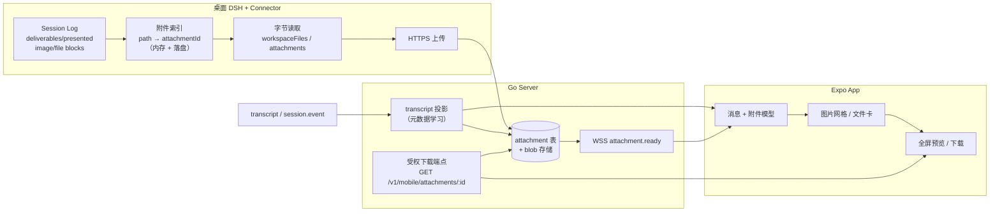
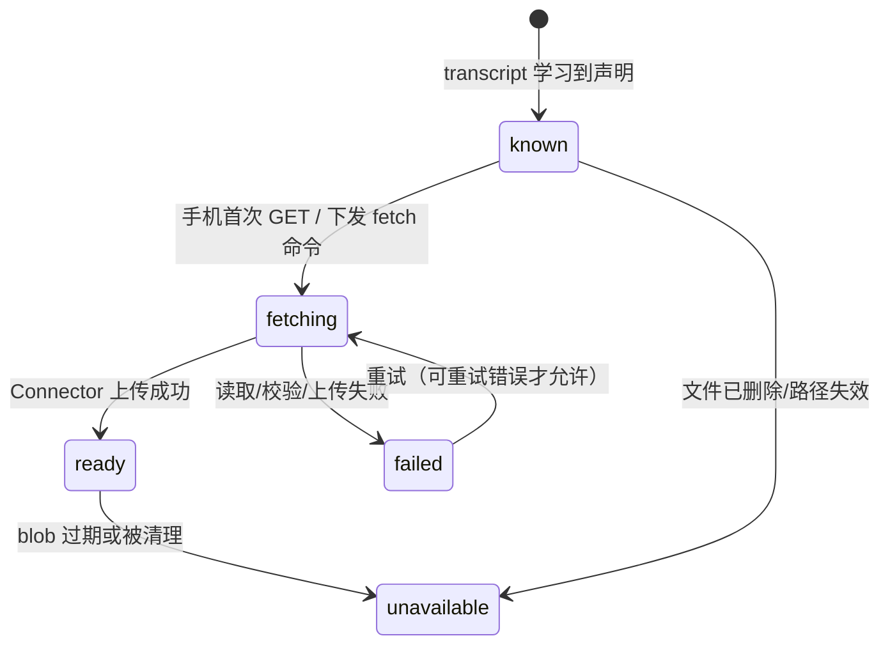
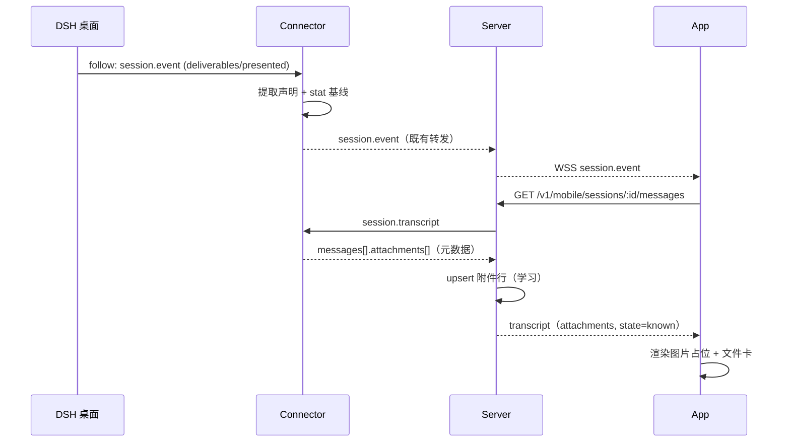
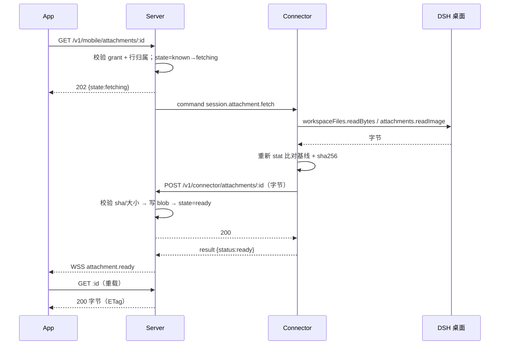

# 移动端文件与图片展示方案设计

## 1. 结论摘要

移动端看不到会话"返回的文件"，不是渲染问题，而是链路上有三处断点同时存在：

1. **Connector 只投影文本。** `session.transcript` 明确丢弃 `tool/call`、`tool/result`，`messageText()` 只拼接 `text` 内容块；`image`/`file` 内容块和 `deliverables/presented` 事件都在这一步被丢掉（`connector/dsh-plugin/src/lib/host-session-adapter.ts:231`、`:609`）。
2. **Server 没有附件通道。** 协议里没有任何 attachment 概念，`MobileMessage` 只有 `text`（`server/internal/protocol/types.go:382`），并且 JSON/RPC 载荷上限是 64 KiB（`server/internal/server/config.go:61`、`connector/dsh-plugin/src/lib/host-rpc.ts:6`），字节不能走事件流。
3. **App 没有附件模型与组件。** `MobileMessage` 无附件字段（`apps/mobile/src/types/mobile.ts:121`），`MessageRow` 只渲染 Markdown 文本（`apps/mobile/src/features/session/chat-screen.tsx:1015`），而且产品上刻意隐藏工具消息（`:884`）。

本方案的一句话结论：

> **由 Connector 从会话事件里"声明"出文件元数据（不含字节、不含路径），随 transcript 下发给手机；手机点开时再由 Connector 按桌面侧校验后把字节上传给 Server 做受权缓存，手机通过独立 HTTPS 端点取图/下载。** 路径永不出桌面，`attachmentId` 不可猜测，字节不进 WSS/JSON。

分阶段落地（M1–M4，范围已确认）：M1 图片闭环（`present` 交付 + `dsh_im_return_file` 允许名单 + 全屏预览），M2 文件卡、交付卡与保存/分享，M3 消息附件与手机上行附件，M4 通知与离线增强。

## 2. 现状与断点

| 环节 | 现状 | 证据 |
|---|---|---|
| DSH 会话日志 | 已有 `deliverables/presented`、`image`/`file` 内容块、`tool/call`+`tool/result` | 见第 3 节 |
| Connector transcript | 只保留 `user/message`、`assistant/message` 的文本；工具与非文本块丢弃 | `host-session-adapter.ts:231`、`:609` |
| Connector 实时流 | 全量转发 `session.event`（`connector/dsh-plugin/src/lib/host-session-adapter.ts`），但手机只对 `assistant/message`、`user/message`、`turn/end` 触发刷新 | `apps/mobile/src/lib/session-stream.ts` |
| Server transcript | 透传 Connector 结果，无附件字段 | `server/internal/server/mobile_access.go:377` |
| Server 存储 | 只有用户、设备、授权、幂等、审计；无附件表 | `server/ent/schema/` |
| 传输上限 | JSON/RPC 载荷 64 KiB | `config.go:61`、`host-rpc.ts:6` |
| App 渲染 | 纯文本/Markdown 气泡，无 Image/File 组件 | `chat-screen.tsx:1015`、`components/markdown.tsx` |

结论：DSH 侧"文件是存在的"，是 Connector 的展示契约把它过滤掉了；补齐需要贯穿三端的契约扩展，而不是只改 UI。

## 3. DSH 侧能力依据（锁定 0.2.1-rc.5）

### 3.1 `present` 工具：DSH 原生的"交付文件"

`@deepseek-ai/dsh-tool-present` 声明最终交付物，成功后追加一条**持久会话事件**：

```ts
// dsh-tool-present/lib/types/types.d.ts
'deliverables/presented': {
  turn: number;
  callId: ToolCallId;
  files: { path: string; description?: string }[]; // 新声明存绝对路径
};
```

- `standard`、`ptc`、`cordis` 三个预设默认挂载该工具（`presets/standard.patch.yml:121`）。
- 可交付 shell 生成的文件，`maxFiles` 默认 8；不复制文件内容，只记录路径。
- 这是**跨工具、跨预设**的稳定来源，应作为一等来源。

### 3.2 消息附件：`image` / `file` 内容块

`dsh-llm` 的内容块里附件是**不可变引用**，没有路径、没有 base64：

```ts
interface ImageBlock { type: 'image'; attachment: ImageAttachmentRef; offloaded?: true }
interface FileBlock  { type: 'file';  attachment: FileAttachmentRef }
// ImageAttachmentRef: { attachmentId, mediaType, bytes, width, height, name? }
// FileAttachmentRef:  { attachmentId, name, bytes }
```

Connector 可用 `ctx.attachments.readImage(ref)` / `readFileStream(ref)` 取回校验过的字节（`@deepseek-ai/dsh-attachment`）。注意：目前生产适配器只有用户侧会带图片，assistant 侧图片属于前向兼容。

### 3.3 出站文件工具（IM 通道）：需要兼容

`@xmanrui/dsh-im` 注册了 `dsh_im_return_file`：参数 `{path}`，结果 `{artifactId, fileName, size}`，由通道在 turn 结束后上传发送。它**不写 `deliverables/presented`**，只在内存注册表里登记。若只支持 `present`，IM 场景生成并"返回"的图片在移动端仍然看不到。

兼容做法：识别 `tool/call` 的 `name` 在允许名单内、且同 `callId` 的 `tool/result` 不是错误，就从 `arguments.path` 取出路径作为候选。仅对允许名单生效，避免把任意工具的路径参数当文件外发。

### 3.4 文件读取能力

- `ctx.workspaceFiles.readBytes(scope, path, {range | {}}, signal)`：按 Session 解析相对路径，`lstat` 拒绝非常规文件与 final symlink，有 `maxBytes`/`maxFileBytes` 上限（`@deepseek-ai/dsh-api-workspace-files`）。
- `ctx.attachments.readImage/readFileStream`：校验摘要与长度后再返回字节。
- 沙箱策略可能拒绝读取某些路径，失败必须**关闭**而不是回退到 Node `fs` 直读。

### 3.5 传输约束

| 限制 | 值 | 影响 |
|---|---|---|
| Server JSON body | 64 KiB | transcript 不能内联图片字节 |
| Connector RPC body | 64 KiB | 命令不能回传文件 |
| transcript 文本预算 | 45 000 字符 | 附件元数据必须轻量 |
| 单条消息文本 | 4 000 字符 | 同上 |

因此字节必须走**独立二进制通道**，事件流只带元数据。

## 4. 目标与非目标

**目标**

1. 会话中被"交付/返回"的图片与文件，在移动端以卡片形式出现在对话里，可点开查看。
2. 图片支持全屏查看、缩放、多图切换；文件支持预览（文本类）、下载、保存/分享。
3. 不破坏现有产品偏好：**仍不展示工具调用与工具输出**，附件作为消息的一部分呈现。
4. 安全默认拒绝：手机不能列目录、不能按路径读取、不能访问未声明的文件。

**非目标**

1. 不做移动端桌面文件浏览器（不提供 `list`/任意 `read`）。
2. 不做全量会话文件同步；只缓存"被手机实际打开过"的文件。
3. 不做端到端加密（与 roadmap P3 一致，另立方案）。
4. 不改动会话正文的既有语义与权限模型。

## 5. 总体架构



三条设计原则：

1. **声明驱动（declaration-based）**：手机只能看到"会话里被显式声明交付"的文件；声明来自 `deliverables/presented`、消息附件块、允许名单工具。
2. **元数据与字节分离**：元数据随 transcript 走 JSON；字节走 HTTPS 二进制，拉取式缓存。
3. **桌面是唯一事实源与唯一读盘方**：Server 只做受权副本缓存，App 只持不可猜测的 `attachmentId`。

### 5.1 被否决的备选方案

| 方案 | 否决原因 |
|---|---|
| base64 内联进 transcript | 64 KiB 帧与 45 000 字符预算直接冲突；大图会打断流式与入库 |
| 桌面暴露直连 HTTP 供手机拉取 | 违反"桌面只出站"的架构前提，NAT/防火墙不可行 |
| Server 全量同步会话目录 | 隐私与容量都不可控，且违背"DSH Session Log 是唯一事实源" |
| 手机持有路径、按需请求 | 等于开放任意路径读取，泄露面过大 |

## 6. 数据契约

### 6.1 `MobileAttachment`

```ts
type MobileAttachment = {
  attachmentId: string;              // att_ + 24 字符 base64url，不含路径
  kind: 'image' | 'file';
  name: string;                      // 展示名，已去除路径
  mime: string;                      // 服务端嗅探后以服务端为准
  bytes: number;                     // 声明时的大小
  width?: number;                    // 图片内联尺寸，供布局占位
  height?: number;
  source: 'deliverable' | 'message' | 'tool';
  description?: string;              // present 的描述
  state: 'known' | 'fetching' | 'ready' | 'failed' | 'unavailable';
  errorCode?: string;                // state=failed/unavailable 时
  preview?: { kind: 'text'; text: string }; // 文本类前 1 KiB，可选
};
```

- `width`/`height` 让图片在字节到达前就占好位置，避免流式过程中跳动。
- `preview` 只对 `text/*`、`application/json`、`text/markdown` 生成，上限 1 KiB，计入 transcript 预算。
- `state` 由 Server 覆盖（Connector 只报 `known`），保证同一附件在不同手机上看到一致状态。

### 6.2 transcript 扩展

`MobileMessage` 增加可选 `attachments`，旧客户端忽略即可：

```json
{
  "id": "message-128",
  "seq": 128,
  "role": "assistant",
  "text": "已生成架构图，见附件。",
  "attachments": [
    {
      "attachmentId": "att_b7Qk2m9xT4pL0rVc8sN1",
      "kind": "image",
      "name": "architecture.png",
      "mime": "image/png",
      "bytes": 184320,
      "width": 1280,
      "height": 720,
      "source": "deliverable",
      "description": "本轮的架构图",
      "state": "known"
    }
  ],
  "occurredAt": "2026-11-02T11:37:13Z"
}
```

交付归属规则（避免把文件挂到错误的消息上）：

1. `present` 事件归属于它所在的 **turn**；渲染时挂到该 turn 的**最后一条 assistant 文本消息**上（通常是收尾回复）。
2. 该 turn 没有任何 assistant 文本时，合成一条 `role: "assistant"`、`text: ""`、`delivery: true` 的虚拟消息，`seq` 取交付事件 seq，App 渲染为"本轮交付 N 个文件"卡片。
3. 消息附件块归属于它所在的消息。
4. 同一 turn 多个 `present` 调用：按事件 seq 顺序累加，按 `name` 去重，保留最后一条描述（与 Web 端一致）。

### 6.3 `attachmentId` 规则

```text
att_ + base64url(sha256(sessionId \0 source \0 seq \0 index))[:24]
```

- **确定性**：同一文件在分页、重取、Connector 重启后 id 不变。
- **不含路径**：id 不携带任何路径或文件名信息，无法反推。
- **不跨会话复用**：同一文件被两个会话交付，得到两个 id，各自独立授权。
- 消息附件可用 DSH 的 `attachmentId` 作为 `index` 的一部分，保证同一附件块稳定。

### 6.4 状态机



`ready` 是终态但不保证永存：blob 有 TTL 与容量回收，过期后回到 `unavailable`，重新 GET 可再次触发拉取（`unavailable` 允许重试一次以刷新声明）。

### 6.5 新增 Connector 命令

```json
{
  "v": 1,
  "type": "command",
  "requestId": "req_01J8...",
  "method": "session.attachment.fetch",
  "params": {
    "sessionId": "sess_...",
    "workspaceId": "ws_...",
    "attachmentId": "att_b7Qk2m9xT4pL0rVc8sN1"
  },
  "timeoutMs": 60000
}
```

返回值（`result`）：

```json
{ "status": "ready", "bytes": 184320, "sha256": "9f2c…", "mime": "image/png" }
```

错误码：`attachment_unknown`、`attachment_unavailable`、`attachment_changed`、`attachment_too_large`、`attachment_denied`；旧 Connector 不认识该方法时返回既有的 `method_not_found`。

### 6.6 新增 Server 端点

| 方法与路径 | 调用方 | 作用 |
|---|---|---|
| `POST /v1/connector/attachments/{attachmentId}` | Connector | 上传字节（`application/octet-stream`），幂等 |
| `GET /v1/mobile/attachments/{attachmentId}` | App | 取字节；未就绪时 `202` 并触发拉取 |
| `GET /v1/mobile/sessions/{sessionId}/messages` | App | 既有端点，响应新增 `attachments` 并回填 `state` |

可选：`GET /v1/mobile/attachments/{attachmentId}/meta` 用于只取元数据（App 当前用不上，可延后）。

上传请求头：

```http
POST /v1/connector/attachments/att_b7Qk2m9xT4pL0rVc8sN1
Authorization: Bearer <device token>
Content-Type: application/octet-stream
Content-Length: 184320
X-DSH-Attachment-Sha256: 9f2c...
X-DSH-Attachment-Session: sess_...
X-DSH-Attachment-Bytes: 184320
```

下载响应：

| 状态 | 含义 | 响应 |
|---|---|---|
| `200` | 就绪 | 字节 + `Content-Type` + `ETag` + `Cache-Control: private, max-age=300` |
| `202` | 正在拉取 | `{"state":"fetching","retryAfterMs":800}` + `Retry-After: 1` |
| `403` | grant 失效/工作区不匹配 | 既有错误信封 |
| `404` | 未知或已过期附件 | 既有错误信封 |
| `409` | 桌面侧文件已变更/删除 | `{"state":"failed","errorCode":"attachment_changed"}` |
| `413` | 超过上限 | 既有错误信封 |

### 6.7 新增移动事件（可选但推荐）

拉取完成后由 Server 向该 `(deviceId, sessionId)` 的移动 WSS 广播：

```json
{
  "v": 1, "type": "event", "kind": "attachment.ready",
  "deviceId": "dev_...", "sessionId": "sess_...",
  "data": { "attachmentId": "att_...", "bytes": 184320, "sha256": "9f2c…" }
}
```

App 可用它立即重载图片，无需轮询。`EventHub.Broadcast` 已按 `(deviceId, sessionId)` 过滤（`server/internal/server/hub.go:113`），可直接复用。

## 7. Connector 设计

### 7.1 新增模块

```text
connector/dsh-plugin/src/lib/
├── attachment-extract.ts   # 事件 → 声明（纯函数，易测）
├── attachment-index.ts     # sessionId → Map<attachmentId, 声明>；落盘重建
├── attachment-fetch.ts     # 读取字节 + 上传 Server
└── attachment-policy.ts    # 路径/大小/类型/敏感名单
```

### 7.2 声明提取流水线

在一次 `page()` 的 records 上按 seq 顺序扫描：

1. `deliverables/presented` → 每个 `files[i]` 生成一条声明（`source: 'deliverable'`，`index: i`）。
2. `user/message` / `assistant/message` → 遍历 `message.content`：
   - `image` / `file` 块 → 声明（`source: 'message'`，引用 DSH 附件）；
   - 其它块忽略。
3. `tool/call`（允许名单 `['dsh_im_return_file']`）→ 暂存 `callId → {name, arguments}`。
4. `tool/result` → 若 `message.toolCallId` 命中暂存且 `message.isError !== true`，解析 `arguments.path` 生成声明（`source: 'tool'`）。
5. 每条声明做一次 `stat`（`lstat` + `realpath`）取 `bytes`、`mtime`、`inode`，作为后续一致性校验基线；失败则跳过并计数（不阻塞 transcript）。

产出：`TranscriptMessage.attachments[]`，等宽、有序、去重。

### 7.3 路径与安全校验（`attachment-policy.ts`）

按顺序执行，任一失败即拒绝：

1. 路径非空、无 NUL、长度 ≤ 1024、非 URL。
2. `realpath` 后必须落在允许根内：
   - 默认：该会话 workspace 根；
   - 例外：`present` 声明且桌面设置 `allowOutsideWorkspaceDeliverables=true`（**默认 `false`**，已确认）。
   - 默认拒绝时仍登记元数据并置 `state=failed`、`errorCode=attachment_denied`，手机显示"该文件在工作区外，需在桌面开启允许"，便于用户理解而不是静默消失。
3. `lstat` 必须是 regular file；**拒绝 final symlink**（与 `workspaceFiles` 语义一致）。
4. 大小 ≤ `maxAttachmentBytes`（默认 20 MiB）；否则登记为 `state=failed`、`errorCode=attachment_too_large`，手机显示"文件过大，请在桌面查看"。
5. 命中敏感名单一律拒绝，与开关无关：`.ssh/`、`id_rsa`、`id_ed25519`、`.aws/credentials`、`.env`、`*.pem`、`*.key`、`/etc/shadow`、`Cookies`、`Login Data`。
6. 每次 fetch 重新 `stat`，与声明基线比对 `(dev, ino, size, mtimeNs)`；不一致返回 `attachment_changed`，**绝不发送变化后的内容**。

产物中不出现原始路径：Connector 只在内存/落盘索引里保存路径，对外只暴露 `attachmentId` 与展示名。

### 7.4 索引与重启重建

- 内存索引：`sessionId → Map<attachmentId, Declaration>`，随 `session.transcript` / `session.event` 增量更新。
- 落盘：`~/.dsh-connect/attachments/<sessionId>.json`（含声明与基线，不含文件内容），限制单文件 256 KiB、总条数 500。
- 重启后按需重建：先读落盘索引，缺失的会话在下次 transcript 请求时自然补齐。
- 索引失效（文件被删）不删除记录，标记 `unavailable`，便于手机看到明确状态而非"永远转圈"。

### 7.5 fetch 实现

```ts
async fetch(params, { signal }) {
  const decl = this.#index.require(params.sessionId, params.attachmentId); // 不在索引 → attachment_unknown
  const scope = await this.#workspaceScope(params.sessionId);
  const stat = await this.#stat(decl, scope);            // 变更 → attachment_changed
  const bytes = await this.#readBytes(decl, scope, signal); // ≤ maxAttachmentBytes
  const digest = sha256(bytes);
  await this.#upload(decl.attachmentId, bytes, digest);   // 等 Server 200 再返回
  return { status: 'ready', bytes: bytes.length, sha256: digest, mime: decl.mime };
}
```

- 上传必须**在命令返回前完成**，避免 Server 在命令超时后仍收到孤儿字节。
- 同一 `attachmentId` 并发 fetch 用 single-flight 合并，避免重复读盘与上传。
- 上传失败按 `attachment_failed` 返回，可重试；4xx（如 404 附件未知）不重试。

### 7.6 transcript 预算

- 每条消息最多 4 个附件，超出的折叠为 `+N`（元数据仍保留，UI 展开时再拉）。
- 45 000 字符预算按「正文 + 展示名 + `preview`」计算，`preview` 上限 1 KiB/附件；超预算时沿用现有逻辑从最旧的完整消息开始裁剪。
- 整体 JSON 需 < 60 KiB（留 4 KiB 余量给信封）。

## 8. Server 设计

### 8.1 数据模型（ent）

```go
// SessionAttachment 缓存一个会话声明的文件及其字节来源。
// 行由 transcript 响应"学习"得到，不由手机上报。
func (SessionAttachment) Fields() []ent.Field {
    return []ent.Field{
        field.String("id").Unique().NotEmpty().Immutable(), // att_...
        field.String("device_id").NotEmpty(),
        field.String("session_id").NotEmpty(),
        field.String("workspace_id").NotEmpty(),
        field.String("source").NotEmpty(),   // deliverable | message | tool
        field.Uint64("source_seq"),
        field.Uint32("source_index"),
        field.String("display_name").NotEmpty(),
        field.String("mime").NotEmpty(),
        field.Int64("bytes").Default(0),
        field.String("sha256").Optional(),
        field.String("state").Default("known"),
        field.String("error_code").Optional(),
        field.Time("created_at").Immutable().Default(time.Now),
        field.Time("updated_at").Default(time.Now).UpdateDefault(time.Now),
        field.Time("expires_at"),
    }
}
```

`preview` 不落库：它只在 transcript 响应中透传，避免 Server 持久化文件内容（与 `docs/01-system-architecture.md` 12.2"默认不持久化完整会话正文"保持一致）。

索引：`(device_id, session_id)`、`expires_at`、`state`。

字节与元数据分离：内容寻址存文件，DB 只存引用（避免 TOAST 膨胀，天然去重）：

```go
// AttachmentBlob：按 sha256 去重，字节写 DSH_CONNECT_ATTACHMENT_DIR。
func (AttachmentBlob) Fields() []ent.Field {
    return []ent.Field{
        field.String("sha256").Unique().NotEmpty().Immutable(),
        field.String("mime").NotEmpty(),
        field.Int64("bytes"),
        field.String("storage_path").NotEmpty(), // <dir>/<sha[0:2]>/<sha>
        field.Time("created_at").Immutable().Default(time.Now),
        field.Time("last_used_at").Default(time.Now),
    }
}
```

`DSH_CONNECT_ATTACHMENT_DIR` 默认 `<data>/attachments`；容器部署需挂卷，否则重建后 blob 丢失（元数据仍在，可重新拉取）。

### 8.2 学习型索引

Server 不需要手机或 Connector 单独上报声明：**在处理 `GET .../messages` 时，把 Connector 返回的 `attachments` upsert 进表**（按 `attachmentId` 主键，冲突则更新元数据、保留既有 `state`）。这样：

- 任何手机能看到的附件，Server 必然有对应行；
- 未知 `attachmentId` 一律 `404`，从源头阻断枚举；
- 多手机天然共享同一行，状态一致。

`state` 覆盖规则：`ready` 不因新的 transcript 回落；其余以最新为准。

### 8.3 下载端点

```go
func (s *Server) handleMobileAttachment(w http.ResponseWriter, r *http.Request) {
    row, err := s.store.SessionAttachment(r.Context(), r.PathValue("attachmentId")) // 不存在 → 404
    if err != nil { writeAPIError(w, protocol.NewError(protocol.CodeNotFound, "attachment not found", false)); return }
    // 用行内归属反向校验：只校验 grant 与工作区，不信任请求参数
    if _, commandError := s.authorizeMobileSession(r, row.DeviceID, row.WorkspaceID, row.SessionID, "read"); commandError != nil {
        writeAPIError(w, *commandError); return
    }
    switch row.State {
    case "ready":    s.serveAttachmentBlob(w, r, row)
    case "fetching": writeAttachmentPending(w)
    case "known":    s.enqueueAttachmentFetch(row); writeAttachmentPending(w)
    default:         writeAttachmentFailed(w, row)
    }
}
```

要点：

- **反向授权**：不信任查询参数里的 `deviceId`/`workspaceId`，一律用 DB 行内的归属校验，杜绝"拿着 A 会话的 id 走 B 工作区授权"。
- **触发拉取要幂等**：`known → fetching` 用条件更新（`WHERE state='known'`），并发 GET 只发一次命令。
- **上传校验**：`POST /v1/connector/attachments/{id}` 用既有 `store.AuthenticateDevice` 解析 device token，校验与行内 `device_id` 一致、`Content-Length` 等于行内 `bytes` 且不超过全局上限、`sha256` 与 body 一致；成功后写 blob、置 `ready`、广播 `attachment.ready`。
- **响应头**：`Content-Type` 用服务端嗅探结果（magic bytes，不信任扩展名）；`X-Content-Type-Options: nosniff`；内联白名单仅 `image/png|jpeg|webp|gif`、`text/plain`、`text/markdown`，其余 `Content-Disposition: attachment`；`ETag` 用 sha256；支持 `If-None-Match` → `304`。
- **CORS**：移动 Web 构建（react-native-web）需要 `Access-Control-Allow-Headers` 含 `Authorization`，`Access-Control-Allow-Origin` 用既有白名单逻辑（`server/internal/server/admin_auth.go:90`）。

### 8.4 缓存、去重与回收

- 去重：同名不同内容按 sha256 区分；重复上传直接复用 blob。
- TTL：行 30 天、blob 7 天未访问（可配置），由后台 goroutine 每小时清理一次。
- 容量：`maxAttachmentStoreBytes`（默认 2 GiB），超限按 `last_used_at` LRU 淘汰。
- 清理后行置 `unavailable`，下次 GET 可重新拉取。

### 8.5 审计与限流

- 审计：`attachment.fetch` / `attachment.denied` / `attachment.too_large`，只记 `deviceId`、`sessionId`、`attachmentId`、`bytes`、结果，**不记路径、不记文件名**（文件名可能含敏感信息；展示名已在手机侧）。
- 限流：每手机 60 次/分钟、每会话 500 MiB/小时；超限 `429`。
- 命令超时：`session.attachment.fetch` 用 60s（读盘 + 上传），超过返回 `command_timeout`，行回到 `failed`。

### 8.6 配置项

| 环境变量 | 默认 | 说明 |
|---|---|---|
| `DSH_CONNECT_ATTACHMENTS` | `read` | `off` / `read` / `readwrite`（后者含上行附件） |
| `DSH_CONNECT_MAX_ATTACHMENT_BYTES` | `20971520` | 单文件上限 |
| `DSH_CONNECT_MAX_ATTACHMENT_STORE_BYTES` | `2147483648` | blob 总容量 |
| `DSH_CONNECT_ATTACHMENT_TTL` | `168h` | blob 未访问回收 |
| `DSH_CONNECT_ATTACHMENT_DIR` | `<data>/attachments` | blob 目录 |

## 9. 移动端设计

### 9.1 类型与 API

```ts
// apps/mobile/src/types/mobile.ts
export type MobileAttachment = { /* 见 6.1 */ };
export type MobileMessage = { /* 既有字段 */ attachments?: MobileAttachment[]; delivery?: boolean };

// apps/mobile/src/lib/mobile-api.ts
export function buildAttachmentUrl(serverUrl: string, attachmentId: string): string;
export async function downloadMobileAttachment(input: {
  serverUrl: string; token: string; attachmentId: string; name: string; sha256?: string;
}): Promise<{ uri: string; bytes: number }>;  // 落 FileSystem.cacheDirectory
```

图片直接用 `expo-image`：`<Image source={{ uri, headers: { Authorization: 'Bearer …' } }} cachePolicy="memory-disk" />`。`expo-image` 支持 `source.headers` 与 `prefetch(urls, { headers, cachePolicy })`（已装 `~58.0.18`），不需要额外轮子。

### 9.2 渲染位置与组件拆分

```text
apps/mobile/src/components/
├── attachment-grid.tsx     # 图片网格 + 点击
├── attachment-card.tsx     # 文件行卡 + 状态
├── attachment-viewer.tsx   # 全屏预览 Modal（缩放、翻页）
└── delivery-summary.tsx    # "本轮交付 N 个文件" 折叠组（M2）
apps/mobile/src/features/session/
└── use-attachment.ts       # 状态、下载、缓存、重试
```

`MessageRow` 在正文与 footer 之间插入 `<AttachmentList message={message} />`；`role === 'tool'` 仍不渲染（保持既有偏好），只在底部保留"已省略 N 个工具调用与输出"。

两个与既有逻辑的衔接点：

- **语音播报**：`text` 为空的交付卡不参与自动朗读；现有"最后一条 assistant 文本自动播报"（`chat-screen.tsx:428`）需跳过空文本，避免朗读空白。
- **去重与分页**：附件随消息 `seq` 合并，现有 `Map<seq, message>` 去重逻辑可直接复用；虚拟交付消息使用事件 `seq`，不会与真实消息冲突。

### 9.3 图片网格规则（390 pt 基准）

| 数量 | 布局 |
|---|---|
| 1 | 单图，宽度撑满，最大高 320，`contentFit="cover"` |
| 2 | 2 列，1:1 方格 |
| 3 | 2 列，首图跨 2 列（1 大 + 2 小） |
| ≥4 | 2×2 方格 + 右下角 `+N` 蒙层 |

- 圆角 12，间距 6，点击进入全屏。
- 未加载时用 `width/height` 占位 + 骨架色，避免消息高度跳动。
- `state !== 'ready'` 时先显示占位；`fetching` 时角标转圈。

### 9.4 文件卡

```text
┌──────────────────────────────────────┐
│ [PDF]  架构说明.pdf            1.2 MB │
│        2026-11-02 20:31   ·   下载 ↓  │
└──────────────────────────────────────┘
```

- 图标按 MIME 家族着色（pdf/doc/xls/zip/code/text/image）。
- 主行：文件名（1 行省略）+ 大小；次行：描述（若有）或类型 + 时间。
- 右侧状态：`下载` → 进度 → `打开`；失败显示 `重试`。
- `text/*` 且 ≤ 256 KiB：直接显示"预览"按钮，在本地 sheet 渲染纯文本（不依赖第三方 PDF 组件）。
- 其它类型：`打开` = 下载到缓存后调用系统打开（M2 引入 `expo-sharing`）。

### 9.5 全屏预览

- `Modal` + 黑色背景 + `react-native-gesture-handler` 捏合缩放/双击放大/拖拽，`reanimated` 驱动，退出时回弹。
- 多图横向 `FlatList` 分页，顶部 `3 / 7` 计数，底部文件名 + 大小。
- 顶部右侧：保存/分享（M2）、关闭；图片加载失败显示重试。
- 无障碍：`accessibilityLabel="第 3 张图片，共 7 张，architecture.png"`；支持系统字号放大。

### 9.6 状态与失败处理

| state | UI |
|---|---|
| `known` | 占位/灰底 + 名称与大小；点击触发拉取 |
| `fetching` | 骨架 + 角标 progress |
| `ready` | 正常图片/文件卡 |
| `failed` | 缩略图位显示错误图标 + "加载失败，点击重试"；文件卡显示错误码文案 |
| `unavailable` | "文件已在桌面删除或过期" + 隐藏打开按钮 |

补充两条客户端细节：

- **就绪后换 URL**：`ready` 后给图片 URL 追加 `?v=<sha256 前 8 位>`，避免图片缓存把早期的失败态或旧版本固化。
- **404 视为"索引未就绪"**：附件行通常由 transcript 学习而来；若首帧并发导致 `404`，界面按 `known` 处理并重试一次，不清空消息。

错误文案映射到现有 `describeMobileApiError` 风格，新增 `attachment_*` 分支（`apps/mobile/src/lib/mobile-api.ts`）。

### 9.7 性能与缓存

- **按需加载**：只有进入可视区才发请求（`expo-image` 默认懒加载行为 + `recyclingKey`）。
- **首屏流量**：M1 对 `bytes > 2 MiB` 的图片先显示占位、点击后才加载原图，`≤ 2 MiB` 自动加载；M2 增加 `?w=320` 缩略图变体（服务端用 Go `golang.org/x/image` 解码并缓存）。
- **预取**：进入会话时对本轮图片调用 `Image.prefetch([...], { headers, cachePolicy: 'memory-disk' })`，最多 6 张、单张 ≤ 2 MiB。
- **磁盘缓存**：图片由 expo-image 管理；文件下载到 `cacheDirectory/dsh-attachments/`，以 `sha256` 作文件名、以元数据 `bytes` 校验长度（sha256 内容校验需额外引入 `expo-crypto`，列为可选增强）。
- **清理**：登出、撤销授权、切换 Server 时调用 `Image.clearDiskCache()` 并清空附件目录，避免残留已失权内容。
- **内存**：全屏预览只保留当前图 ±1 张的高清资源；网格在 M1 用原图 + `contentFit`，M2 切到 `?w=320` 缩略图。

### 9.8 线框图

```text
┌─────────────────────────────────┐
│ ←  会话                    ⋯    │
├─────────────────────────────────┤
│                       你  20:31 │
│                帮我画一张架构图 │
│                                 │
│ DSH  20:32                      │
│ ┌─────────────────────────────┐ │
│ │ 已生成，见下图。            │ │
│ │ ┌─────────────────────────┐ │ │
│ │ │                         │ │ │
│ │ │        [ 图片 ]         │ │ │
│ │ │                         │ │ │
│ │ └─────────────────────────┘ │ │
│ │ architecture.png · 180 KB   │ │
│ │ ┌─────────────────────────┐ │ │
│ │ │ [MD] 架构说明.md  18 KB │ │ │
│ │ └─────────────────────────┘ │ │
│ │ 本轮交付 2 个文件   朗读 20:32│ │
│ └─────────────────────────────┘ │
│                                 │
│ ┌─────────────────────────────┐ │
│ │ 输入指令…              ↑    │ │
│ └─────────────────────────────┘ │
└─────────────────────────────────┘
```

## 10. 关键时序

### 10.1 声明与展示



### 10.2 首次打开图片



### 10.3 文件下载与保存

```text
点击文件卡
  → GET :id（必要时 202 → 等 attachment.ready）
  → 200
  → FileSystem.downloadAsync 到 cacheDirectory/dsh-attachments/<sha>-<name>
  → 校验字节数（sha256 内容校验需引入 expo-crypto，可选）
  → 文本：本地 sheet 预览
  → PDF/Office：expo-sharing 分享（M2）或系统打开
  → 图片：expo-media-library 保存到相册（M2，需权限）
```

## 11. 安全与隐私

| 威胁 | 攻击面 | 对策 |
|---|---|---|
| 手机按路径读取桌面任意文件 | 构造请求参数 | 手机**从不提交路径**；只提交不可猜测的 `attachmentId`；Connector 用自建索引校验 |
| 工作区越权 | 复用 A 工作区授权读 B 会话附件 | 行内归属反向校验；grant + workspace + device 三重校验 |
| 撤销授权后继续访问 | 已缓存 URL/字节 | 每次请求校验 grant；登出/撤销清缓存；blob 设 TTL |
| 敏感文件外泄（`~/.ssh`、`.env`） | 模型 `present` 了私钥 | 默认仅 workspace 内；敏感名单硬拒绝；桌面开关控制 workspace 外 |
| 符号链接逃逸 | `link → /etc/passwd` | `lstat` 拒绝 final symlink + `realpath` 根内校验 |
| TOCTOU（声明后被替换） | 声明安全文件，读取时换成敏感文件 | 记录 `dev/ino/size/mtimeNs`，fetch 时比对，变化即拒绝 |
| 类型欺骗（SVG/HTML 内联执行） | 恶意 MIME | magic bytes 嗅探；内联白名单；`nosniff`；非白名单强制下载 |
| 大文件 DoS | 单文件/批量 | 单文件 20 MiB、单轮 50 MiB、速率限制、`413` |
| 附件 id 枚举 | 遍历 id | id 含 session/seq 的 sha256，24 字符 base64url；未学习到的 id 直接 404 |
| 日志泄露文件名/路径 | 审计与日志 | 审计只记 id/大小/结果，不记路径与文件名 |
| 图片 EXIF 定位 | 相机原图 | M2 可选：Connector 上传前剥离 EXIF（需图片库，默认关闭） |
| 桌面被"钓鱼交付" | 模型诱骗用户批准 | 附件随消息展示 `source` 标识；桌面设置可关闭 workspace 外交付 |
| 恶意或异常的 Connector 声明 | 被篡改的插件把任意文件登记为交付 | 桌面安装本身是信任边界；服务端只接受"已被 transcript 学习过"的附件；全部拉取写审计 |

补充：附件内容不进入事件流、不进入 PostgreSQL 事件表，只在 blob 存储中；Server 重启不影响元数据。

## 12. 兼容与灰度

| 场景 | 行为 |
|---|---|
| 旧 App + 新 Server | 忽略 `attachments` 字段，行为不变 |
| 新 App + 旧 Server | 端点 404 → 附件区隐藏，不报错 |
| 新 App + 旧 Connector | `session.attachment.fetch` 返回 `method_not_found` → 复用现有"桌面 Connector 版本较旧"文案（`apps/mobile/src/lib/mobile-api.ts`） |
| 旧 Connector + 新 Server | transcript 无 `attachments`，一切照旧 |
| 未挂载 `present` 的预设 | 无交付事件；仅消息附件与工具兼容生效 |
| 关闭附件能力 | `DSH_CONNECT_ATTACHMENTS=off` → 端点 404、transcript 不投影附件 |

灰度建议：Server 开关默认 `read`（可看可拉不可写）；Connector 侧 `attachments.enabled` 默认 `true`；`allowOutsideWorkspaceDeliverables` 默认 `false`；先在单桌面验证再全量。

协议兼容：`MobileMessage.attachments` 为可选字段，`protocol/schemas/v1/mobile.schema.json` 中 `additionalProperties: false` 需要在同一次改动里加入该字段，并在 `openapi.yaml` 记录新端点。

## 13. 分阶段落地

### M1：图片闭环（已确认先做）

| 端 | 改动 |
|---|---|
| Connector | `attachment-extract.ts`、`attachment-index.ts`、`attachment-fetch.ts`、`attachment-policy.ts`；transcript 投影；`session.attachment.fetch`；上传；允许名单工具（`dsh_im_return_file`）提取；单测 |
| Server | 两张 ent 表；transcript upsert；`GET/POST` 两个端点；`attachment.ready` 广播；审计；配置 |
| Mobile | `MobileAttachment` 类型；`buildAttachmentUrl`；图片网格；最小"交付"虚拟消息（仅图片，保证无文本 turn 也能显示）；全屏预览（缩放）；状态与重试；`session-stream` 处理 `attachment.ready` |
| 协议 | `mobile.schema.json` + `openapi.yaml` + `asyncapi.yaml` 增补 |

验收：

- `present` 交付的 PNG 在手机以网格出现，点开可放大、翻页。
- 无 assistant 文本的 turn 仍能看到它交付的图片（最小交付消息，不要求完整交付卡）。
- 撤销 grant 后同一 URL 返回 403；重新授权后恢复。
- 25 MiB 的交付文件被拒（`413`），桌面显示原因。
- 桌面删除文件后手机显示 `unavailable`，不无限转圈。
- workspace 外的交付默认被拒，手机显示 `attachment_denied` 与原因。
- IM 场景经 `dsh_im_return_file` 返回的图片同样出现在手机（允许名单默认开启）。

### M2：文件卡、交付卡与保存

- 文件卡、文本预览、PDF/Office 下载后打开；`expo-sharing`、`expo-media-library`（需 `npx expo install` + 重建 dev build）。
- 完整交付卡组件 `delivery-summary.tsx`（数量、折叠、批量保存/分享）。
- 服务端可选缩略图变体（`?w=320`），降低弱网首屏成本。
- 验收：文本/PDF/图片保存与分享全链路；缓存清理在登出时生效。

### M3：消息附件与上行

- 消息 `image`/`file` 内容块投影（用 `ctx.attachments.readImage/readFileStream`）。
- 手机上行：选图/选文件 → 上传 Server → Connector 拉取 → `ctx.attachments.admitPromptContent()` → prompt content parts 扩展。
- 验收：用户在手机发一张图给桌面，桌面会话历史能看到该图。

### M4：通知与离线

- `deliverables/presented` 触发 APNs/FCM："本轮交付 3 个文件"。
- 后台预取策略与离线查看（加密缓存，另行设计）。

## 14. 测试计划

| 层 | 用例 |
|---|---|
| Connector 单测 | 事件→声明提取（含多文件、去重、turn 归属）；id 确定性；路径拒绝（越界、symlink、目录、NUL、敏感名单）；fetch 前后 stat 变更；single-flight；上传失败重试 |
| Connector E2E | 仿真 Host 发 `deliverables/presented` → transcript 带附件 → fetch → 假 Server 收到字节 |
| Server 单测（pgtest） | 上传鉴权（错 device、错 session）；大小上限；sha 不符；学习型 upsert；`known→fetching→ready` 条件更新；下载 202/200/409/413；ETag/304；grant 撤销后 403；并发 GET 只发一次命令 |
| 协议 | JSON Schema 校验新旧样例；openapi 契约测试 |
| 移动端 | `tsc --noEmit` + ESLint；手工矩阵（iOS/Android、深浅色、弱网、超长文件名、0/1/2/3/4/9 张图） |
| 安全 | 手机构造未知 id、跨会话 id、撤销后重放、超大 payload、`../` 与 symlink 场景 |

## 15. 风险与开放问题

| 风险 | 影响 | 缓解 |
|---|---|---|
| DSH 版本漂移（事件名/附件 ref） | 提取失效 | 所有版本相关逻辑收敛在 `host-session-adapter` 与 `attachment-extract`；锁定 rc.5；契约测试 |
| `present` 未挂载或模型不调用 | 无交付 | M1 兼容 `dsh_im_return_file` 允许名单；M3 增加"提示词约定"并在系统提示里引导 |
| 文件在声明后被修改 | 发错内容 | stat 基线比对 + 内容摘要 |
| 弱网大文件 | 体验差 | 20 MiB 上限、进度、Range、M2 缩略图 |
| 存储增长 | 成本 | 内容寻址去重、TTL、LRU、容量上限 |
| 撤销后本地缓存残留 | 隐私 | 登出/撤销清 expo-image 磁盘缓存与附件目录 |
| 手机端 `Image` 请求头在 Web 构建受限 | Web 预览失败 | 服务端 CORS 放行 `Authorization`；Web 用 fetch→blob URL 兜底 |

## 16. 已确认的决策

2026-11-02 与需求方确认，按下列结论执行：

| # | 决策 | 结论 | 影响 |
|---|---|---|---|
| 1 | workspace 外交付文件是否允许手机查看 | **默认不允许**；桌面开关 `allowOutsideWorkspaceDeliverables=false`，显式开启后仍写审计 | `present` 指向 `/tmp`、Downloads 等路径时，手机显示 `attachment_denied` 与原因；不静默隐藏 |
| 2 | 字节缓存策略 | **拉取式 + 点开才拉** | 手机不预取全量；首屏只加载 ≤ 2 MiB 图片，其余点击后加载 |
| 3 | M1 范围 | **只做图片**；文件卡、完整交付卡组件进 M2 | 无 assistant 文本的 turn 仍需最小"交付"虚拟消息，否则图片无处挂载 |
| 4 | 是否引入 `expo-sharing` / `expo-media-library` | **M2 引入**（`npx expo install` + 重建 Development Build） | M1 只做应用内预览，不提供保存/分享入口 |
| 5 | `dsh_im_return_file` 作为一等来源 | **默认开启 + 允许名单** | IM 通道返回的文件不再缺失；允许名单可配置关闭 |

第 5 项的理由：`dsh_im_return_file` 只在 IM 插件内存里登记文件，**不写 `deliverables/presented`**；只支持 `present` 会让"在 IM 里生成并返回图片"这一真实场景在手机上仍然看不到文件。把它作为一等来源并限定允许名单，可以在不外发任意工具路径参数的前提下补齐这条来源。

## 17. 附录

### A. 错误码

| 码 | 来源 | 含义 | 可重试 |
|---|---|---|---|
| `attachment_unknown` | Connector | id 不在会话声明索引 | 否 |
| `attachment_unavailable` | Connector | 文件已删除、不可读或被沙箱拒绝 | 否（重载 transcript 后可能恢复） |
| `attachment_changed` | Connector | 声明后文件被修改 | 否 |
| `attachment_too_large` | Connector | 超过单文件上限 | 否 |
| `attachment_denied` | Connector | 路径策略或敏感名单拒绝 | 否 |
| `attachment_failed` | Connector | 读盘/上传失败 | 是 |
| `attachment_not_ready` | Server | 仍在拉取 | 是（202） |
| `attachment_expired` | Server | blob 过期 | 是（重新拉取） |

### B. 协议片段

```json
// GET /v1/mobile/attachments/att_... → 202
{ "state": "fetching", "retryAfterMs": 800 }

// GET → 409（桌面文件已变更）
{ "state": "failed", "errorCode": "attachment_changed" }

// POST /v1/connector/attachments/att_... → 200
{ "state": "ready", "bytes": 184320, "sha256": "9f2c…" }
```

### C. 与现有文档的关系

- 架构与安全基线：`docs/01-system-architecture.md` 第 9、12、13 节。
- 阶段与验收：`docs/04-implementation-roadmap.md`（本方案把 P3 的"图片和附件"提前为可独立交付的 M1/M2）。
- 移动端工程约束：`apps/mobile/AGENTS.md`（Expo SDK 版本化 API、lint/typecheck 门槛）。